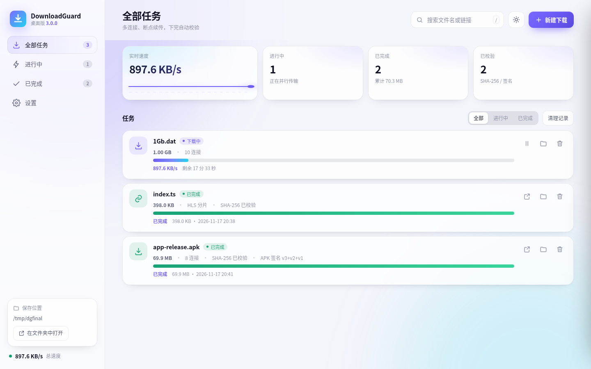
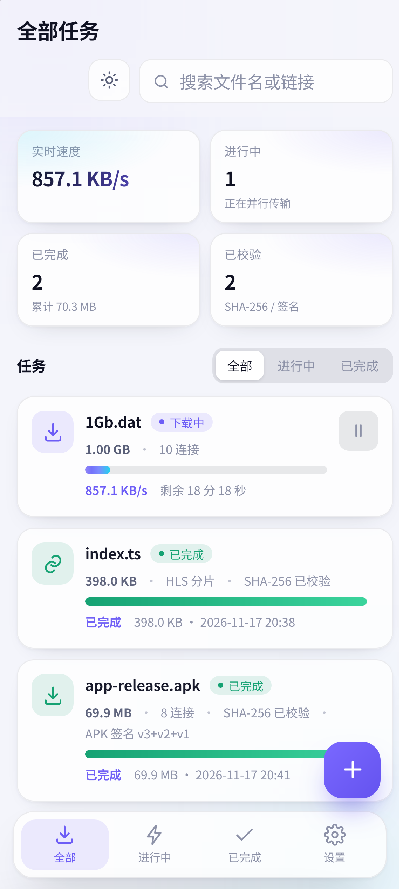

# 浏览器下载接管 · DownloadGuard

[](https://github.com/zhaofan128/download-guard/actions/workflows/ci.yml)
[](https://github.com/zhaofan128/download-guard/releases/latest)
[](LICENSE)
[](https://developer.android.com)
[](https://kotlinlang.org)
[](#电脑版windows--macos--linux)

一个不需要 root 的下载工具：**把浏览器里点不动的下载按钮接过来**，用最多 256 连接把文件拉快，多个任务并行排队、随时暂停继续，下完再逐字节校验，确认没坏才交给你。2.2.0 起内置完整的 **BT / 磁力下载**；**3.0.0 起有了电脑版**——与手机版功能对等、代码各自独立的 Java 实现，Windows / macOS / Linux 通用，界面自适应 320px 手机到 4K 桌面；**3.1.1** 补上「全部暂停 / 全部继续」、电脑版命令行投递，并把本机服务对浏览器的信任边界收紧。

> 很多下载站的「下载」按钮是 JS 绑定的，长按复制不到真实地址；很多浏览器下大文件只给单线程；很多 APK 下完才发现签名被改过；磁力链接浏览器根本打不开。这四件事，它一起解决。

- Kotlin + Coroutines + Jetpack Compose（Material 3）
- 最低 Android 8.0（API 26），compileSdk / targetSdk 34
- 无需 root；Shizuku、LSPosed 均为**可选**增强，不装不影响任何核心功能
- 电脑版：纯 Java 11 实现，**零第三方依赖**，一个 106 KB 的 jar；界面用系统浏览器渲染，手机/平板连同一 WiFi 也能打开（`--lan`，带随机令牌）
- **180 个 JVM 单元测试、32 个测试类，CI 强制零跳过**：CI 先构建 Debug 包给验签用例当样本，测试跑完直接读 JUnit XML，`skipped > 0` 就判红。本地没构建过 APK 时验签用例会自动跳过，这是 JVM 单测的固有限制——所以「零跳过」只在 CI 上成立，README 不再含糊成「本地也是」
- 覆盖范围：分块调度器的并发一致性、测速决策、哈希基准解析、网络层嗅探判定、全局熔断阶梯、旁挂哈希解析、脚本沙箱逃逸面、HLS 播放列表与 AES-128 分片、磁力链接解析、BT 状态映射与限速展示、真实 APK 的 v2 签名摘要重算

## 它做不到什么（先看这里，比看功能列表省时间）

| 场景 | 现状 | 原因 |
| --- | --- | --- |
| `blob:` 地址 | **不支持** | 媒体数据由页面 JS 在内存里生成，没有可请求的 URL；WebView 不暴露 blob 内容 |
| HLS 点播（`.m3u8`） | **支持**（2.1.0 起） | 按分片顺序拼接，标准 AES-128 自动解密，可断点续传 |
| HLS 直播 / DRM（SAMPLE-AES、Widevine、FairPlay） | **明确拒绝** | 直播没有终点；DRM 解密属于绕过版权保护，不做 |
| DASH（`.mpd`） | **不支持** | 清单 + 分片 + 多轨合并的工程量与 HLS 不是一个量级，暂时只识别并提示 |
| 验证码 / 强人机校验（含 Cloudflare 五秒盾） | **可能过不去** | WebView 里的挑战失败时只能回浏览器手动完成，App 不伪造浏览器指纹 |
| Cloudflare 一次性令牌（`__cf_chl_tk`） | **几分钟后失效** | 令牌与 IP、UA、时间绑定，过期只能回原页面重新获取 |
| 需要多步接口才能换出真实地址的站点 | **做不了** | 内置脚本插件只做 URL 字符串变换，不能发请求、不能读文件 |

这张表会随着能力变化更新，不写「理论上支持」。

桌面版另有 **54 项内置自检**（`--selftest`，无需 JUnit）：JSON 往返、分段覆盖与字节守恒、文件名清洗、Content-Disposition、错误文案、任务序列化、Host/Origin 判定、目录白名单与软链逃逸、分段重试预算、Content-Range 起点、真实签名 APK 的 **v2 验签**、篡改/去签名拒绝、证书指纹提取。CI 里提供真实样本，0 跳过。

再加 **76 项端到端检查**（`desktop/test/e2e.py`，起真 HTTP 服务器、真下载、真杀进程）：服务器忽略 Range 时暂停再续传不能错位、支持 Range 时杀进程重启必须字节一致、1MB chunked 不能变 1 字节、截断响应必须失败、跨站请求/无令牌/白名单外目录必须被拒、HLS 半截分片与清单变更、`part` 缺失与 `tasks.json` 损坏、20 个 SSE 连接不拖垮 API、真实 APK 验签与篡改隔离。CI 里独立一个 job 跑编译 + 自检 + 端到端 + 真实下载 smoke test。

关于测试的实话：180 个用例全是 JVM 单测（含一条「下载临时文件 → v2 验签」的字节级集成用例），**没有 instrumented test，也没有 Compose UI 自动化**。Service、无障碍、Xposed、Shizuku 这些链路靠真机手动验证，CI 覆盖不到。仓库没有 issue/PR 历史，所有「实测」「用户反馈」类结论都应视为未独立复核。

## 哪些系统能用

两种交付形态、两套独立实现（功能对等，不共享源码）：**Android APK** 装在手机上跑，**桌面版 jar** 在任何有 Java 的电脑上跑。手机访问电脑版走浏览器，不需要安装任何东西。

> 为什么不共享代码：Android 端 90% 的价值在 Shizuku、无障碍接管、通知栏这些系统能力上，它们在桌面 JVM 里没有对应物；硬抽一层公共内核，只会让两边都被对方的抽象拖住。共享的是协议与设计约定（任务状态机、`.meta.json` 字段语义、错误文案规范），源文件不共享。详见下方「共享代码边界」。

| 系统 | 装 APK | 用电脑版 | 说明 |
| --- | --- | --- | --- |
| Android 8.0+ | ✅ | ➖ | 完整体验：嗅探、无障碍接管、BT 内置、签名体检 |
| HarmonyOS 4.x 及更早 | ✅ | 浏览器 | 系统仍兼容 AOSP，直接装 `arm64` 包 |
| HarmonyOS NEXT（5.0+，纯血鸿蒙） | ❌ | 浏览器 | 已移除 Android 兼容层，APK 装不上；用华为浏览器开电脑版 |
| iOS / iPadOS 14+ | ❌ | 浏览器 | 不允许侧载，也没有 JVM；Safari 开电脑版后可「添加到主屏幕」 |
| Windows 10/11 | — | ✅ | 双击 `start-windows.bat` |
| macOS 10.15+ | — | ✅ | 双击 `start-macos.command` |
| Linux（x86_64 / arm64） | — | ✅ | `./start-linux.sh` |
| Chrome OS | ✅ | 浏览器 | 支持装 Android 应用 |

### iOS 和鸿蒙 NEXT 为什么装不了

不是没做适配，是这两条路在系统层面被堵死了：

- **iOS** 只允许从 App Store 安装应用，侧载需要企业证书或越狱；而且 iOS 上根本没有 Java 运行时，桌面版的 jar 也跑不起来。
- **HarmonyOS NEXT** 从 5.0 起删掉了 AOSP 兼容层，APK 是「格式不被识别的文件」，必须用 ArkTS 重写成 `.hap` 才能安装。

### 那这两类设备怎么用

**让电脑干活，手机当遥控器。** 电脑上执行 `java -jar DownloadGuard-Desktop-3.1.1.jar --lan`，终端会打印一个带随机令牌的地址：

```
http://192.168.1.5:8765/?token=8f3c2a...
```

同一 WiFi 下用 iPhone / 鸿蒙手机打开这个地址，就是完整界面：建任务、看进度、暂停、改设置全部可用，文件下载在电脑上。

- **iOS Safari**：点分享 → 「添加到主屏幕」，会得到一个独立图标、全屏无地址栏的窗口，和原生 App 的观感一致（已配好 `apple-touch-icon`、`apple-mobile-web-app-capable` 与刘海安全区）。
- **鸿蒙 NEXT**：华为浏览器直接打开即可，同样可以「添加到桌面」。
- 令牌每次启动随机生成，没有令牌的请求返回 403；不要把带 token 的地址发给别人。

局限也要说清楚：**下载任务不在手机上跑**。手机关掉浏览器，下载照常进行（因为它在电脑上）；但电脑关机就全停了。

## 下载

**[⬇ 下载最新版](https://github.com/zhaofan128/download-guard/releases/latest)**

3.1.1 起同时提供 **电脑版** 与 **Android 版**，能力对等、版本号同步。

### 电脑版（Windows / macOS / Linux）

下载 `DownloadGuard-Desktop-3.1.1.zip`，解压后双击对应脚本（需要 Java 11+，不用装 Android SDK、不用编译）：

| 系统 | 启动方式 |
| --- | --- |
| Windows | 双击 `start-windows.bat` |
| macOS | 双击 `start-macos.command` |
| Linux | 终端执行 `./start-linux.sh` |

启动后自动打开浏览器；关掉浏览器不会中断下载，回到终端按 `Ctrl + C` 才退出（会先保存断点）。

想让手机、平板用同一套界面：

```bash
java -jar DownloadGuard-Desktop-3.1.1.jar --lan
```

终端会打印形如 `http://192.168.1.5:8765/?token=…` 的地址，同一 WiFi 下用手机浏览器打开即可。令牌每次启动随机生成，没有令牌的请求一律 403。

### Android 版

下载后直接安装。首次启动会引导授予「所有文件访问权限」与「通知权限」，之后把链接粘进来就能用。

3.1.1 同时提供两个包，功能完全一致，只是打包的原生库架构不同：

| 包 | 大小 | 适用 |
| --- | --- | --- |
| `DownloadGuard-3.1.1-arm64.apk` | 约 24.4 MB | 2018 年之后的绝大多数手机（arm64-v8a），**推荐**，下载快、不易传坏 |
| `DownloadGuard-3.1.1-universal.apk` | 约 73 MB | 全架构（arm64 / armv7 / x86 / x86_64），老设备或模拟器 |

> **装不上先核对字节数**。APK 的签名块在文件末尾，下载中断会留下一个「能识别成 APK、但没有签名」的半截文件，安装器报的就是「安装包没有签名文件」。用文件管理器看属性里的精确大小，和 Release 页面写的字节数对上再装（同一份源码在不同签名与时间戳下会差几 KB，以 Release 页面为准）。

### 校验下载到的文件

每个 Release 都附一份 `CHECKSUMS.txt`（SHA-256）。下载后在同一目录执行：

```bash
sha256sum -c CHECKSUMS.txt        # macOS: shasum -a 256 -c CHECKSUMS.txt
```

或者让脚本代劳（需要 `gh` 已登录，下载到临时目录后逐项比对）：

```bash
./scripts/verify-release.sh v3.1.1
```

同一版本号的资产一旦发布就不再替换；任何二进制变化都会发新的修订号。历史版本 `2.2.0` 曾在同版本号下替换过 APK，这是错误的，不能作为可复现基准——如果你记录过当时的哈希，请以对应 commit 的构建产物为准，不要拿它校验后来的 `2.2.0` 文件。

桌面版 jar 是**可复现构建**：同一份源码、同一个 JDK 大版本，打出来的字节完全一致（`desktop/build.sh` 把条目 mtime 钉死为 2000-01-01，并按字典序写 zip 条目；CI 每次都会连打两次比对哈希）。所以你可以自己从 tag 构建一遍再核对：

```bash
git checkout v3.1.1 && cd desktop && ./build.sh
sha256sum ../dist/DownloadGuard-Desktop-3.1.1.jar
# 与 CHECKSUMS.txt 里那一行对比，一致就说明这份 jar 确实由这个 tag 的源码产出
```

范围只说桌面版：APK 这条链没有做可复现构建，也没有验证过 Gradle 出包的字节稳定性，所以不对 APK 承诺「同样源码同样哈希」。APK 的信任链走签名（v2 真实摘要校验 + 证书指纹）。


---

## 电脑版（Windows / macOS / Linux）

| 桌面端 | 手机浏览器 |
| --- | --- |
|  |  |

不是把 Android 界面塞进 Electron，也不是另写一套 Swing。电脑版是「**本地服务 + 系统浏览器**」：

- 启动时只监听 `127.0.0.1`，用系统默认浏览器打开；字体、缩放、触控滚动跟随系统，Windows 高分屏不会糊。
- 界面是响应式的：≥1120px 左侧完整导航，720–1120px 收成图标栏，<720px 换成底部标签栏 + 悬浮按钮，380px 以下再压一档。**同一套 UI 在电脑、平板、手机上都是原生手感**，不用装 App。
- 下载内核是独立的 Java 实现（与 Android 版不共享代码，功能对等）：分段并发、断点续传、全局限速、HLS + AES-128、BT（走本机 aria2c）、SHA-256、**APK v2 验签**、失败文件隔离。
- 状态推送用 SSE，断线自动重连并有轮询兜底；所有分段进度落盘，进程被杀也能续。
- 不点界面也能用：`--add <链接> --wait` 投递并等结果，`--status` 看队列，脚本和 CI 不用模拟浏览器点击。
- 纯 Java 11、零第三方依赖：jar 约 190 KB（含四套图标），没有 npm、没有 node_modules、没有运行时补丁。

| 能力 | 电脑版 | Android 版 |
| --- | --- | --- |
| 多连接分段下载 | ✅ 1–32 连接 | ✅ 最多 256 |
| 断点续传 | ✅ | ✅ |
| 全部暂停 / 全部继续 | ✅ | ✅ 3.1.0 起 |
| 命令行投递（脚本 / CI） | ✅ `--add` / `--status` | ➖ |
| HLS 点播 + AES-128 | ✅ 可调 ffmpeg 封装 mp4 | ✅ |
| BT / 磁力 | ✅ 需本机 aria2c | ✅ 内置 libtorrent4j |
| 下载后 SHA-256 计算与基准比对 | ✅ 可填期望值，不符隔离 | ✅ 支持旁挂哈希 |
| APK v2 签名验签 | ✅ 篡改/去签名直接失败 | ✅ 多级校验；v3-only 标注未验证 |
| 浏览器下载接管 | ➖ 直接粘贴链接 | ✅ 嗅探 + 无障碍 |
| 手机远程使用 | ✅ 浏览器打开，无需安装 | ➖ |

完整说明、参数与常见问题见 [desktop/README.md](desktop/README.md)。

---

## 它解决什么问题

| 痛点 | 做法 |
| --- | --- |
| 下载站的下载按钮没有 `href`，点一下走 JS，复制链接只能复制到网页地址 | 内置 WebView 嗅探页，五路并行抓真实地址：`DownloadListener` + 导航拦截 + DOM 扫描打分 + 请求层 `shouldInterceptRequest` + **响应体层（注入 JS 读 fetch/XHR 的 JSON 返回）** |
| 直链有防盗链，换个 UA 就 403 | 嗅探时把来源页 `Referer` 与登录态 `Cookie` 一并带给下载器 |
| 浏览器单线程下载，大文件几百 KB/s | 独立 TCP + 块级调度 + 工作窃取，尾段不再掉速；并发上限按设备堆大小分档（32/64/128/256），不再给小内存机硬塞 256 条 |
| 下完的 APK 装不上，才知道包是坏的 | 下载完成立即做结构 / CRC / v2 验签，坏了自动隔离并给出重下入口 |
| 手机厂商的「安装前安全检测」把第三方 APK 判成「已损坏」 | 标准系统安装器路径 + 权限引导；被 ROM 拦死时可选用 Shizuku 直装 |

---

## 特点

| 特点 | 具体是什么 |
| --- | --- |
| **零特权** | 全部功能在普通应用权限内完成，不需要 root、不需要 Xposed、不需要 Shizuku。后者只是可选加速项 |
| **下载与校验一体** | 市面上的多线程下载器大多只管拉快，不管拉对。这里的每次下载都会走完五级校验，出问题立刻告诉你哪一级没过 |
| **不谎报结果** | 拿不到文件长度就降级流式下载并显式标注，而不是假装在算进度；校验没跑成就报「未校验」，不会写成「通过」 |
| **嗅探带登录态** | 抓到直链的同时把 `Referer` 和 `Cookie` 一起交给下载器，防盗链站点不会一换 UA 就 403 |
| **可对官方哈希** | 粘贴官网公布的 MD5 / SHA-256 逐字节比对；嗅探页也能从网页里提取候选值，下载完成自动核验 |
| **遇阻会退让** | 连续 403/429 时自动把并发减半重试（256→128→…→1），并遵守服务器给的 `Retry-After`，不硬冲到被封 IP |
| **全站一起退** | 熔断按 **host** 记账而不是按任务：同一站点的任一任务撞上 429，其余任务在 250ms 内一起降并发并冷却，不会出现「A 已退让、B 还在 256 猛冲」把自己 IP 送走 |
| **首包不等黑洞** | 解析出双栈地址后并发做 TCP 探测，按实测 RTT 排序再连；IPv6 有地址没路由时不再白等 15 秒 `connectTimeout` |
| **误判有出口** | 加壳包、企业定制包被结构校验拦下时，可在隔离区「信任并恢复」，指纹（SHA-256+大小）记入白名单，不再重复误报 |
| **绝不删你的文件** | 判定损坏只做「移动到隔离区」，原文件名、时间戳、目录结构全部保留，随时可以拿回来；App 内下载失败的分片同样进隔离区，不再直接 `delete()` |
| **BT / 磁力也能下**（2.2.0） | 内置 libtorrent4j 引擎：DHT/PEX/LSD 自动找节点，磁力拉元数据、种子文件直接下，可选文件、可限速、断点续传，下完持续做种 |
| **开源可自建** | MIT 协议，签名密钥不入库，任何人 clone 下来都能编译出可用的包 |

---

## BT / 磁力下载（2.2.0 起）

底部导航的「BT」页是一个独立的 BT 客户端，基于 [libtorrent4j](https://github.com/aldenml/libtorrent4j)（MIT）。它和 HTTP 下载分开——BT 有做种、节点、分享率这些独有概念，塞进同一张卡片反而混乱。

- **添加任务**：粘贴 `magnet:?xt=urn:btih:…`（支持 40 位 hex 与 32 位 base32，明确拒绝 v2 的 `btmh`），或点文件夹图标选本地 `.torrent`。
- **元数据**：磁力链接刚加上时走 DHT/PEX/LSD 找元数据，状态显示「获取元数据」，拿到后自动开始下载。
- **文件选择**：多文件种子可以在「文件」里勾选要下的文件，勾掉的标记 `IGNORE` 不占空间。
- **速度控制**：全局下载/上传限速（KB/s，留空不限），任务支持暂停/继续、重新校验、移除（保留文件）或连文件一起删。
- **断点续传**：任务清单（来源 + 暂停状态）存本地，重启 App 自动重建；进度由 libtorrent 对磁盘文件做 hash check 得出，不依赖可能失真的进度快照。会话状态（DHT 节点等）单独持久化，加快冷启动。
- **做种策略**：下载完成后持续做种，直到你手动暂停或删除——这是 BT 生态的默认礼仪。

> **体积代价**：libtorrent 的 native 库每个 ABI 约 16.6 MB，四个架构（arm64-v8a / armeabi-v7a / x86 / x86_64）全打进去后 APK 约 73 MB（此前约 8 MB）。这是为了任何 Android 8+ 设备装上就能用，不做 ABI 阉割。如果你的设备只有 arm64，未来可提供单架构精简版。

> **合规**：BT 是中立传输协议，本功能不提供任何资源搜索、索引或推荐。请只下载你有权获取的内容。

---

## 功能

### 一、下载完整性守护

常驻前台服务盯着下载目录，文件落盘后自动走完五级校验：

1. **大小** — 与 DownloadManager / MediaStore 声明的字节数比对，短了直接判 `TRUNCATED`
2. **ZIP 结构** — 扫尾部 64KB 找 EOCD，校验中央目录偏移与长度，识别截断
3. **全条目 CRC32** — 遍历每个 entry 流式计算 CRC 与声明值比对，同时核对解压字节数
4. **APK 解析** — `PackageManager.getPackageArchiveInfo()`，`.apks/.xapk` 会先解出 base.apk
5. **签名** — APK Signature Scheme v2 分块摘要重算（1MB 分块、`0xa5` 叶子 / `0x5a` 根）+ 公钥验签 + 证书公钥一致性；`.apks` 内全部 split 的证书集合必须一致

结论只有 `OK` / `TRUSTED` 和具体错误类型，**不会把「没验成」写成「通过」**。损坏文件移动到隔离区保留原文件名与时间戳，从不删除用户文件。

> 内置下载器是边下边校验，磁盘上的文件叫 `xxx.apk.part`。类型判定用的是**最终文件名**而不是物理文件名——早前按物理名取扩展名会得到 `part`，L4/L5 被静默跳过，界面上却照样显示「校验通过」。这个缺陷在 2.2.0 修复，并加了 `DownloadedPartVerificationTest`：把真实 APK 复制成 `.apk.part`，对这份临时文件重算 v2 分块摘要，再改一个字节验证必须失败。

五级校验证明的是「传输没坏、签名没被改」，证明不了「这就是官方发布的那一份」。所以补了两条：

- **外部哈希比对**：记录详情里可以粘贴官网公布的 MD5 / SHA-256，App 流式计算整文件摘要后逐字节比对（不是 APK 签名摘要，两者不是一回事）；嗅探网页时也会从页面文本里提取候选值，下载完成后自动核验
- **信任并恢复**：加壳包、企业定制包这类结构校验天生过不了的文件，用户可以在隔离区点「信任并恢复」。文件放回原位，`SHA-256 + 字节数` 指纹记入白名单，同名同内容的文件不再重复隔离；记录里会写清楚「这是用户决定信的」，不是「校验通过」

监控用三通道互补：`FileObserver` 递归监听 + MediaStore `ContentObserver` + 4 秒轮询，覆盖 25+ 个常见下载路径（含微信、QQ、UC、夸克、网盘客户端）。文件大小连续 3 秒无变化才判定下载结束，避免下到一半就校验。

### 二、内置加固下载器

- **256 连接**上限，块级调度而非固定分段：文件先切成比连接数更多的细块，空闲连接先领新块，领不到就去「偷」慢连接未完成区间的后半段；worker 跑在独立调度器上，不受 `Dispatchers.IO` 默认 64 线程限制
- **多任务队列**：同时挂多个下载任务，每个任务独立「暂停 / 继续 / 删除 / 重试」；同时下载任务数 1~5 可调，超出的自动排队、前面的完成自动补位；任务多了支持**全部暂停 / 全部继续**，地铁里要临时让出带宽不用逐条点
- **下载中热切换并发**：拖滑杆即可在 1~256 之间实时调整，调度器每 250ms 增删 worker，已有连接不断、一块进度都不丢（旧版改并发只能取消重下）
- **暂停 / 继续**：暂停保留 `.part` 与 `.part.meta`，继续时按断点续传；只有「取消」才真正丢弃任务
- **尾段不掉速**：允许拆分尚未开始的大块（64KB 粒度、10 层拆分），让所有连接一起收尾，解决「越下越慢最后 50KB/s」
- **fsync 去竞争**：所有 worker 不再各自 fsync 同一个文件（内核按 inode 加锁会互相阻塞），改成抢到节流阀的那个统一刷，实测这是高并发掉速的主因之一
- **断点续传**：`.part.meta` 记录每块进度，校验 `ETag` / `Last-Modified`，服务器文件变了自动从头
- **极速测速**：只测上限档一档（600ms 采样），约 0.7 秒直接给出最快并发；速度低于 1.5MB/s 才补测 16 连接一档（低带宽下高连接握手开销占比大）；32MB 同窗口字节级对比，首字节到达才开始计时
- **自适应降并发**：连续 8 秒速度低于峰值 40% 且并发 ≥ 16 时，自动降到 8 并提示（很多 CDN 对高并发有惩罚，高连接反而只有几十 KB/s）
- **未知长度降级**：服务器拒绝 `HEAD` 和 `Range` 时，自动退成单连接流式写入，而不是直接失败
- **fsync 策略**：大块强制落盘做可靠性锚点，尾段小块交给 4 秒全局 ticker，不为了「安全」把 eMMC 打成随机写
- **错误可读**：403 会说「链接可能过期或需要浏览器验证」，并给一个「用网页模式打开」的按钮，让 WebView 过完验证后带 Cookie 重下
- **全局主机熔断（1.9.0）**：按 host 维护一份所有任务共享的并发额度。429/503 按 256→128→64→32→16→8→4→2→1 逐级减半并给 3~30 秒冷却，403 只降到 16（那是防盗链不是速率问题）；并发 worker 的同一波失败按 750ms 合并只记一次；连续成功 24 次恢复一档，闲置 60 秒直接回满；网络切换时清空重评
- **双栈竞速选路（1.9.0）**：双栈结果先并发探测 443（320ms 超时），按 RTT 排序返回，黑洞地址排到最后；纯 IPv4/纯 IPv6 不做探测（没有选择就没有收益）；结果缓存 60 秒，切网自动失效
- **旁挂哈希自动校验（1.9.0）**：下载前探测 `xxx.apk.sha256` / `.sha256sum` / `.md5` / `.sha1`（含 `file.apk → file.sha256` 变体），只接受纯文本、拒绝 HTML 错误页、校验文件里写的是别的文件名就放弃；命中后自动作为官方基准，完成后直接给「一致 / 不符」
- **收尾不再假死（1.9.0）**：100% 后进入「校验完整性 → 写入文件」两阶段，持有 `PARTIAL_WAKE_LOCK`（10 分钟超时兜底，异常也释放），UI 显示具体动作而不是干等；大包十几秒的哈希 + 签名校验不会再被系统冻结在半路
- **HLS 点播下载（2.1.0）**：`.m3u8` 不再只是「识别后提示」——主列表按码率挑最高一路，媒体列表逐片顺序下载并拼接；标准 `AES-128` 用播放列表自带的密钥地址解密；每下完一片把「播放列表指纹 + 片号 + 字节数」写进 `.part.hls`，中断后从断点接着下。直播（无 `ENDLIST` 且非 VOD）与 DRM（`SAMPLE-AES`、非 identity `KEYFORMAT`）直接拒绝，不产出半截文件

### 三、网页链接嗅探

粘贴网页地址时不会盲下 HTML，而是先探测内容类型，是网页就交给嗅探页（四路并行）：

- `DownloadListener`：页面自己发起下载时拿最终地址
- `shouldOverrideUrlLoading`：脚本跳转到 `.apk` 时拦下来
- DOM 扫描：`a[href]` / `data-*` / `onclick` 里的直链，按后缀与关键词打分排序
- **请求层** `shouldInterceptRequest`：看 XHR / Fetch 的 URL 与 `Accept` 头，只观察不干预，返回 `null` 让页面照常加载
- **响应体层** 注入幂等 JS 钩子挂住 `fetch` / `XMLHttpRequest`，把 `json` / `text` 响应（≤256KB）回传给原生层，从返回体里正则提取直链。`fetch` 用 `clone()` 读，不消费页面自己要用的那个 Response；这是「页面元素里没有链接、地址在接口 JSON 里」的站点的唯一可行抓法

嗅探时还会做两件事：

- **识别流媒体**：`.m3u8` 直接可下（点播 + 标准 AES-128，见上一节）；`.mpd` / `.ts` / `.m4s` 会明确标出来并说明为什么不能单独下。内置下载器不做 DRM 解密（工程量之外，绕 DRM 本身有法律风险），但至少不会让用户白等一个几 KB 的播放列表
- **提取页面里的官方哈希**：从可见文本里找 `SHA256:` / `MD5:` 标签值与裸的 64/32 位十六进制串，作为候选列出来。**默认不选用** —— 页面内容本身不可信，自动采纳等于让攻击者同时控制文件和校验基准

抓到链接后，连同当前页的 `Referer` 和 `CookieManager` 里的 Cookie 一起交给下载器——这是防盗链站点能正常下载的前提。`blob:` 开头的地址抓不到，这是 WebView 的边界，会明确提示而不是假装在下载。

### 四、安装包安装（标准路径）

点校验完成的 APK，走 `FileProvider` + `ACTION_VIEW` 交给系统安装器，这是 Android 的标准做法，**不需要 root、不需要 Shizuku**。

- 未授权「安装未知应用」时弹窗引导，跳转开关页，返回 App 自动继续装
- 逐包 `grantUriPermission`，解决部分 ROM 安装器读不到 `content://` 导致的「解析包错误」
- 如果 ROM 的安装前检测把安装器拦死（报「安装包已损坏」），对话框里提供一个**可选的** Shizuku 直装入口，仅当设备上真的有 Shizuku 时出现

### 五、插件与浏览器扩展

- **15 个官方内置插件**，全部真实改变下载行为，不是空壳开关：
  「浏览器下载桥」「直链嗅探」「智能并发测速」「网盘直链加速」
  「限速卫士」（全局令牌桶限速）「智能重试」（可调重试次数）「重复文件跳过」（同大小已存在则复用）
  「文件名净化」（去广告后缀）「自动归档」（按类型分子目录）「完成即打开」「UA 伪装」
  「全局限流熔断」「IPv4/IPv6 双栈竞速」「旁挂哈希自动校验」「URL 重写脚本」
- **插件分两层**：
  1. **声明式配置**（默认）：宿主只读 `manifest.json` 里的开关/滑杆/文本项，映射成限速、重试、改名这类既定行为。插件拿不到隔离区、校验结果或任意命令入口——架构上就没有这个面。
  2. **URL 重写脚本**（可选）：一段 Rhino 解释执行的 JS，输入 `url`、输出 `url`。沙箱是硬边界——无网络、无文件、无 `Packages`/`java`、`ClassShutter` 一律拒绝反射，解释模式 + 指令计数 200ms 强制中断，返回值必须是 http/https 且 ≤ 8KB。它不是「能跑任意代码的插件」，能力等价于一个字符串函数。
- 安装第三方插件时记录**来源 URL 与包 SHA-256** 并在详情页展示，事后可核对「我跑的是不是当初装的那一份」
- 插件市场支持搜索、分类、收藏、我的，市场源接 GitHub 仓库（`owner/repo` → raw 内容，`main` 失败回退 `master`）
- 插件配置用声明式 schema（`SWITCH` / `SLIDER` / `TEXT` / `CHOICE`），详情页自动渲染表单，无需为每个插件写 UI
- 局域网桥：手机开 `:8787`，24 位 token 鉴权，64KB 请求体上限，供电脑端把链接推给手机下载
- 浏览器扩展（MV3）打包进 assets，可一键导出 zip 到公共下载目录并深链唤起浏览器扩展管理页

### 六、可选增强

| 能力 | 依赖 | 不装的后果 |
| --- | --- | --- |
| 特权安装、静默授权 | Shizuku | 走系统安装器，多一次授权点击 |
| 原始 URL 回传、下载完成 hook | LSPosed 模块（独立 module，默认不构建） | 用分享入口或手动粘贴代替 |
| 无障碍链接捕获与心跳保活 | 无障碍服务 | 仅少一个入口，不影响下载与校验 |
| 跨应用内嵌页抓取（微信/QQ/钉钉…） | 无障碍服务 + 设置里显式开启 | 默认关闭；只能抓用户点击节点附近的文件直链，普通网页与聊天内容不记录 |

---

## 安装

从 Releases 下载最新的 `DownloadGuard-x.y.z-*.apk`，直接安装。

优先选 `arm64` 结尾的精简包（24 MB）；提示「应用未安装 / 不兼容」时再换全架构包。安装报「没有签名文件」基本都是文件没下完整，核对字节数后重下即可。

装完把浏览器里的下载链接复制过来，或在浏览器里长按链接分享给「浏览器下载接管」。

### 权限：每个都要，但每个都能拒绝

| 权限 | 用来做什么 | 拒绝之后的真实后果 |
| --- | --- | --- |
| **所有文件访问**（`MANAGE_EXTERNAL_STORAGE`，Android 11+） | ① 往公共「下载」目录写文件；② 监听浏览器 / 微信 / 网盘落到公共目录的下载 | **仍能下载**，文件改存 App 私有目录（`Android/data/com.dlguard/files/Download`，卸载即删，可用系统分享导出）；「文件落盘后自动校验」只对自己下的文件生效，管不到别的 App |
| **通知**（`POST_NOTIFICATIONS`） | 进度、校验结论、失败原因 | 只能打开 App 看结果 |
| **前台服务**（`dataSync` / `specialUse`） | 下载与目录监控在后台存活 | 切后台可能被系统回收，大文件建议留在前台 |
| **忽略电池优化**（可选） | 防止厂商省电策略把长任务冻结 | 下载可能被暂停，回来点「继续」即可，断点不丢 |
| **安装未知应用**（只在点开 APK 时申请） | 交给系统安装器 | 只能自己到文件管理器里点安装 |

几个容易被误解的点，一次说清楚：

- **为什么不用 SAF 代替「所有文件访问」**：SAF 只能访问用户手选的那一个目录，也收不到「别的 App 往这个目录写了文件」的通知。要监控浏览器、微信、网盘各自落到公共目录的下载，只有全盘读权限这一条路。
- **Google Play**：`MANAGE_EXTERNAL_STORAGE` 属于需要单独申请的高危权限，上架时要提交用途说明并接受审核。本项目按旁加载（直接装 APK）分发，不依赖商店；如果要上架，得先改成「只用自己的目录 + 用户手选目录」的形态，那会丢掉跨应用监控。
- **其余权限都是可选项**：无障碍、Shizuku、LSPosed 一个都不装，下载、校验、安装、嗅探全部照常工作。

---

## 构建

```bash
git clone https://github.com/zhaofan128/download-guard.git
cd download-guard
./gradlew :app:assembleDebug          # 调试包
./gradlew :app:assembleRelease        # 正式包（需要下面的签名配置）
./gradlew :app:testDebugUnitTest      # 全部单元测试（180 个用例 / 32 个测试类）

cd desktop && ./build.sh             # 电脑版：javac + jar，不经过 Gradle
java -Ddg.apk=desktop/test/fixtures/signed.apk -jar dist/DownloadGuard-Desktop-3.1.1.jar --selftest   # 54 项内置自检
java -jar dist/DownloadGuard-Desktop-3.1.1.jar              # 启动电脑版
```

环境：JDK 17+、Android SDK 34、Gradle 8.6、AGP 8.2.2、Kotlin 1.9.22。

**发布签名**：在项目根目录放 `keystore.properties`（已被 `.gitignore` 排除）：

```properties
storeFile=keystore/your-release.jks
storePassword=******
keyAlias=your-alias
keyPassword=******
```

没有这个文件时，`release` 会自动回退到 debug 签名，方便纯源码构建与本地验证。

可选构建 LSPosed 模块：`./gradlew -PenableXposed :xposed:assembleRelease`。

---

## 工程结构

```
DownloadGuard/
├── app/src/main/java/com/dlguard/
│   ├── core/        文件打开、链接嗅探、格式化、权限引导
│   ├── data/        Room 记录、设置存储、链接捕获库
│   ├── download/    ResumableDownloader、ChunkScheduler、ConcurrencyTuner、DownloadCenter、hls/
│   ├── integrity/   五级校验（EOCD / CRC32 / APK 解析 / v2 签名）
│   ├── plugin/      插件清单、配置 schema、市场源、局域网桥、扩展导出
│   ├── service/     前台守护服务、通知
│   ├── shizuku/     Shizuku 特权通道（可选）
│   ├── ui/          Compose 界面、嗅探页、液态玻璃组件
│   └── work/        WorkManager 兜底任务
├── app/src/test/    180 个 JVM 单元测试（32 个测试类）
├── desktop/         电脑版：纯 Java 11，零依赖，自带 HTTP 服务与响应式 Web UI
│   ├── src/main/java/com/dlguard/desktop/
│   │   ├── Engine.java      分段下载、断点续传、队列、全局限速
│   │   ├── Hls.java         m3u8 解析、AES-128、分片拼接、ffmpeg 封装
│   │   ├── Torrent.java     aria2 JSON-RPC 桥接
│   │   ├── Integrity.java   ZIP CRC + APK v2 内容摘要/验签 + 证书指纹
│   │   ├── Server.java      内嵌 HTTP、REST、SSE、静态资源
│   │   ├── Guard.java       请求来源判定（Host / Origin / Sec-Fetch-Site）
│   │   ├── DirGuard.java    保存目录白名单（真实路径 / 软链逃逸）
│   │   ├── Cli.java         命令行投递（--add / --status / --wait）
│   │   └── SelfTest.java    54 项无框架自检
│   └── src/main/resources/web/   index.html + app.css + app.js（无构建）
├── docs/            README 用截图
├── .github/workflows/ci.yml   每次 push 跑测试 + 编译 Debug 包 + 桌面版自检，测试数为 0 直接失败
├── xposed/          LSPosed 模块（可选，条件编译）
└── dist/            本地构建产物（不随仓库提交）
```

### 共享代码边界

**桌面版和 Android 版是两套独立实现，不共享下载/校验代码。** 早期 README 写「同一个下载内核」是错的，已删除。两边只共享协议与设计约定，不共享源文件：

| 模块 | Android | 桌面版 | 是否共享 |
| --- | --- | --- | --- |
| 分段规划 / 并发调度 | Kotlin `ChunkScheduler` / `ResumableDownloader` | Java `Engine` | 否，各自实现 |
| HLS 解析与 AES-128 | Kotlin `hls/` | Java `Hls` | 否，各自实现 |
| APK 完整性 | Kotlin `integrity/`（v2 验签） | Java `Integrity`（v2 验签） | 否，各自实现 |
| 链接嗅探 | WebView JS + 无障碍 | 无（直接粘贴链接） | 不适用 |
| API / 任务模型 | Room + Kotlin 协程 | JSON 文件 + 线程 | 否 |

后果要说清楚：**同一个 bug 可能在两端各修一次；Android 的 180 个单测覆盖不到桌面版**。桌面版靠 `--selftest`（54 项）和 `desktop/test/e2e.py`（76 项检查）兜底，CI 会真实起服务、真下载、真杀进程。短期不强行抽公共 `core/`：两端 IO 模型、生命周期、错误文案都不同，为了「共享」先重写一遍风险更高；真要收敛，按模块迁移并先建 conformance 测试集，而不是一次性重写。

---

## 已知限制

- **`blob:` 链接抓不到**：媒体数据由页面 JS 在内存里生成，没有可下载的 URL
- **HLS 只支持点播**：直播流与 DRM（`SAMPLE-AES`、Widevine、FairPlay）明确拒绝；音视频分离的流（`#EXT-X-MEDIA:TYPE=AUDIO`）目前只下主视频轨，成品可能没有声音
- **DASH（`.mpd`）不支持**：清单解析、分片对齐与多轨合并是另一套工程量，当前只识别并提示
- **非压缩文件只核对大小**：视频、PDF、图片没有 ZIP 结构，校验到「字节数对不对」为止；这不是偷懒，是这类格式没有内建校验和，硬凑一个反而会误报
- **测速结果偏乐观**：只读窗口内的一小段，那部分常被 CDN 缓存命中；UI 已注明「仅供参考」并给出 100MB 的换算耗时
- **哈希比对依赖用户提供基准**：App 无法判断「官网上写的那个 SHA-256 是不是真的官方」，只能保证「本地文件与你给的值是否一致」
- **验证码 / 强人机校验**：WebView 可能过不去，需要回浏览器手动完成
- **一次性令牌**：带 `__cf_chl_tk` 等参数的地址几分钟就失效，403 时请回原页面重新获取
- **部分 ROM 的安装拦截**：厂商「安装前安全检测」可能拦下所有非商店 APK，需在系统设置里放行，或使用可选的 Shizuku 直装
- **`MANAGE_EXTERNAL_STORAGE`**：旁加载应用可用，但上架 Google Play 需要额外审核
- **双栈竞速不是 RFC 8305**：OkHttp 不暴露 socket 层竞速，这里做的是「解析后并发探测、按 RTT 排序」，效果等价于首包走最快路径，但不是 250ms 错峰并发 connect 的原版算法
- **跨应用抓取有硬边界**：很多 WebView 不把链接暴露给无障碍节点，只能读到可见文本；且必须先由用户开启无障碍与「跨应用抓取」，默认不工作
- **脚本插件只做字符串变换**：不能发请求、不能读文件，所以「需要多步接口才能解析出真实地址」的站点仍然做不了
- **电脑版默认只认本机地址**：Host 必须是 `127.0.0.1` / `localhost` / 本机网卡地址（`--lan` 时）。用 Nginx 反代或自定义域名访问会得到 403，需要显式 `--allow-host your.domain`——这是为了挡 DNS 重绑定，不是配置出错

---

## 合规声明

本项目只做**传输加速**与**完整性校验**：

- 不破解、不绕过任何网盘的会员限速或付费限制
- 不提供任何受版权保护内容的获取渠道
- 插件系统是中立容器，插件行为由插件作者负责；内置的脚本沙箱不提供网络/文件/反射能力，也不提供绕过付费墙或风控的能力
- 跨应用抓取默认关闭，开启后也只识别文件直链，不保存聊天、浏览历史或页面文本
- 请只下载你有权获取的文件，并遵守当地法律与网站服务条款

---

## 版本策略

**新能力才升次版本号，修 bug 只升修订号，攒够一批才发版。**

| 变化类型 | 版本位 | 例子 |
| --- | --- | --- |
| 新增用户可感知的能力 / 不兼容变更 | `x.Y.0` | 1.9.0 全局熔断与双栈竞速、2.0.0 接力网关、2.1.0 HLS 点播 |
| 修 bug、改文案、补文档、加 CI | `x.y.Z` | 2.1.1 修某个站点的下载失败 |
| 纯文档 / CI / 构建脚本，不动 APK | **不发版** | README 纠错、workflow 调整 |

发版前必须：CI 全绿 → `assembleRelease` 能出包 → Release 里写清楚「改了什么、影响了谁」。
不为了刷版本号而发版；`2.0.0 → 2.0.1` 应该是「修了一个真实问题」，而不是「改了一段 README」。

> 这次从 2.2.0 升到 **3.0.0**：多了「在电脑上用」这件事，还改了界面的适配模型（手机/平板/桌面三档断点），属于用户能明确说出的新能力。按 `x.Y.0` 的规则本来只该升到 2.3.0，之所以动 `MAJOR`，是因为交付形态从「一个 APK」变成「APK + 跨平台桌面版」，安装方式、运行环境、安全边界都变了，旧的 2.x 语义已经装不下。
> 2.2.0 的修复（`.part` 跳过验签、调度器竞态、局域网 token）继续保留在 3.0.0 里，没有回退。完整判定规则见 [VERSIONING.md](VERSIONING.md)。
>
> **3.1.0** 回到 `x.Y.0`：新增「全部暂停 / 全部继续」（桌面 + Android）与电脑版命令行投递（`--add` / `--status` / `--wait`）。
>
> **3.1.1** 是安全与正确性修订：桌面版本机 API 在所有模式下强制令牌 + 双提交头 + Origin/Host 校验 + 保存目录白名单；未知长度/chunked 下载改单流并强制收尾校验；APK 从「只识别签名方案」改为真实 v2 验签，篡改/去签名直接失败；HLS 分片原子落盘 + 清单指纹；断点 meta 与 tasks 对齐，杜绝全零 completed。3.1.0 的 APK 未发布，3.1.1 是第一个带这些修复的发布版本。

---

## License

[MIT](LICENSE)
